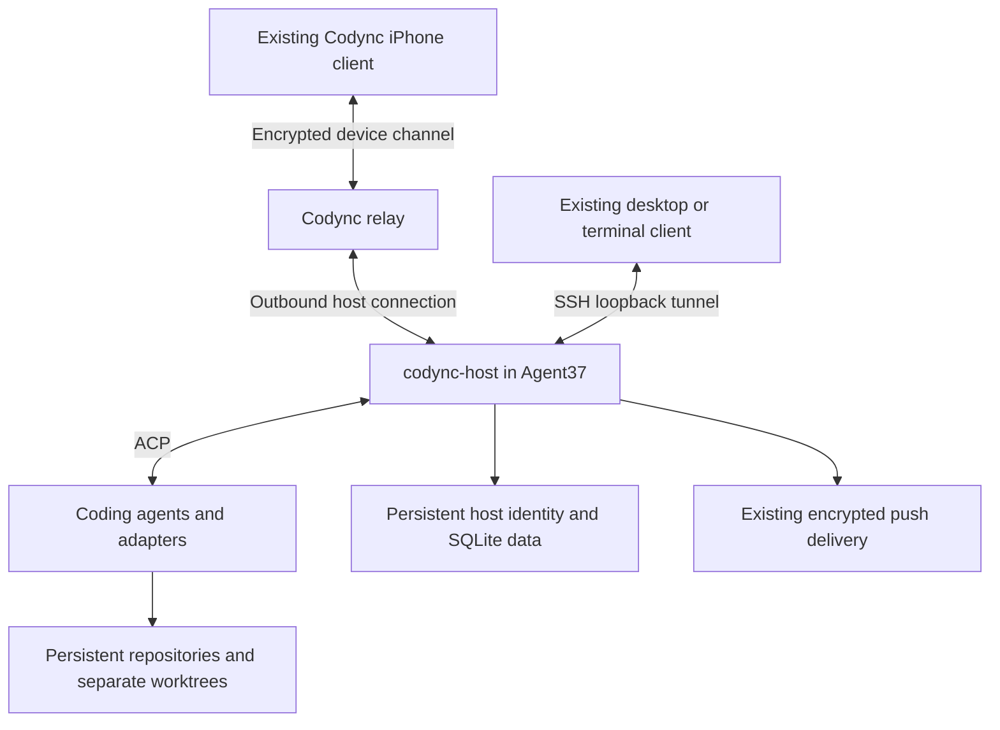

# Agent37 hosting integration plan

Status: proposal. Reviewed on 2026-10-13 against Codync commit
`6ffa4fd8180fc208d19a094facc804254476c194` and Agent37's public documentation.
No Agent37 deployment or device acceptance test has run.

## Goal and first release

Run a personal Codync host and its coding agents in one persistent Agent37
sandbox. The user messages named bots from the existing iPhone, desktop, or
terminal client while their personal computer is off.

Keep Codync responsible for bot identity, ACP sessions, conversations, approvals,
and notifications. Use Agent37 for compute, persistent storage, and administrative
access. Start with two bots and one repository, using separate worktrees for edits.

The first release consists of a reproducible image, an idempotent bootstrap,
deployment instructions, and a recorded acceptance result. It does not add an
Agent37 account screen, automatic provisioning in Codync, a new agent API backend,
multi-tenant hosting, voice changes, or a remote desktop. Existing voice behavior
may be exercised later. Headless hosting does not provide screen control.

## Architecture

The iPhone connects through Codync's encrypted relay. Agent37 SSH provides
administrative access and a candidate desktop connection. The desktop app is not
a phone-to-SSH gateway. Validate the relay first rather than assuming that an
Agent37 preview URL works as a Codync pairing address.

Codync's bearer-token API accepts loopback callers. Keep that restriction. Do not
publish `/api/*` through an Agent37 public port or weaken the caller check to make
proxy access work. An authenticated Agent37 HTTP proxy is not a substitute for
Codync device authorization.

## Verified contracts and open assumptions

The current source and provider documentation establish these contracts:

- Codync supports a Linux foreground host with `codync-host serve`.
- `host/src/service/mod.rs` accepts `CODYNC_HOME` to select the host data directory.
- Agent37 accepts custom Linux images and provides SSH through its WebSocket
  proxy, including port forwarding.
- Agent37 mounts an initially empty persistent volume at `/home/node`. Files baked
  into that directory in the image are hidden at runtime.
- Agent37 does not provide systemd. The image entrypoint must manage startup.
- Codync's [`TRADEMARK.md`](../../TRADEMARK.md) permits its cloud for personal use.
  Hosted, resold, or multi-tenant services require their own cloud infrastructure.
  Redistributed forks require a different name and icon.

These assumptions require live evidence before implementation is accepted:

- The sandbox permits the ACP subprocesses, outbound model connections, relay
  connections, and local MCP tools used by the selected agents.
- The host can produce a usable pairing offer without an advertised private LAN
  address, and the iPhone reaches it through the relay.
- Codync desktop SSH works with Agent37's `ProxyCommand` and key policy.
- Notifications arrive while the iPhone app is backgrounded.
- Restart and image update preserve identity, authorization, chats, and worktrees.

## Proposed artifacts

Create the following during implementation. They are deliverables, not files
provided by this planning change:

| Artifact | Responsibility |
| --- | --- |
| `packaging/agent37/Dockerfile` | Pin the host and toolchain, and install executables outside `/home/node` |
| `packaging/agent37/entrypoint.sh` | Initialize persistent directories, check ownership, and run the foreground host |
| `packaging/agent37/bootstrap.sh` | Prepare runtime configuration without replacing existing identity or credentials |
| `packaging/agent37/verify.sh` | Check host health, persistence, and reconnect behavior without paid model calls |
| `docs/guides/agent37.md` | Describe deployment, agent login, pairing, backup, update, and removal |

Run the application as the image's non-root runtime user. Ensure its account home
resolves to `/home/node`; do not redirect a developer's local home directory.
Set `CODYNC_HOME=/home/node/.codync` explicitly. Use `/home/node/projects` for
repositories and persistent agent directories for credentials and sessions.
Install binaries under `/usr/local/bin` or `/opt`, including npm global packages.

Pin the Codync release or commit, base image digest, and ACP adapter versions.
Check release artifact checksums. Initialize the volume on first boot, and leave
existing configuration untouched on subsequent boots. Never bake tokens or agent
credentials into the image, build context, or Git history.

## Implementation phases and acceptance gates

### Phase 1: prove local container startup

1. Build a Linux amd64 image with the pinned host and one chosen ACP adapter.
2. Configure the runtime user's persistent home and `CODYNC_HOME`.
3. Run `codync-host serve` as the foreground process under a minimal init that
   forwards termination signals and reaps child processes.
4. Mount an empty volume, create a bot, stop the container, and restart it.
5. Recreate the container with the same volume and compare its state.

Acceptance: the host starts without systemd, exits cleanly, and preserves its
identity, bot, and SQLite data. Repeated bootstrap does not reset any state.
Record the image digest and logs with secrets removed.

### Phase 2: prove Agent37 hosting and access

1. Publish the custom template and create one instance with auto-sleep disabled.
2. Inspect health, processes, runtime user, and persistent directory ownership.
3. Establish Agent37 SSH and a loopback tunnel to the host.
4. Verify terminal access, then try the existing desktop SSH flow.
5. Generate a pairing offer, pair a physical iPhone, and connect over cellular
   with Wi-Fi disabled.

Acceptance: the iPhone lists the host's bots through Codync's relay. The terminal
can reach the loopback API through SSH. Record whether desktop SSH works without
changes. If it fails, preserve the exact failure and keep terminal SSH available
while a focused desktop fix is evaluated.

Use the official client for this first test. If custom iOS changes later become
necessary, follow the Linux SwiftPM and xtool workflow. Check `xtool auth status`
and `swift sdk list`, and have the user complete interactive `xtool setup` when
needed. Do not make a custom iOS build a prerequisite for the hosting experiment.

### Phase 3: prove the bot workflow

1. Sign in to the selected coding agents inside the running instance.
2. Create Implementer and Reviewer bots with explicit folders and permissions.
3. Run a small repository task from the iPhone and inspect the actual file diff.
4. Trigger an action that requires approval. Approve it from the phone and confirm
   that execution waits for that approval.
5. Background the phone app and confirm both approval and completion notifications.
6. Ask Implementer to request a review from Reviewer. Inspect both chats and the
   resulting findings.
7. Cancel a running task and confirm the agent stops without reporting success.
8. Reconnect the client and check that the final reply and approval state agree
   with the host's persisted state.

Acceptance: the two bots complete the task, preserve distinct sessions and
permissions, and produce a review of the real changes. Approval, notification,
cancellation, and reconnect behavior all work on the physical phone.
Record agent versions, the test repository commit, observable results, and any
provider usage. Obtain runtime credentials through login or secret injection.

### Phase 4: prove recovery and operating costs

1. Restart the instance and then update it to a new pinned image revision.
2. Verify that the computer identity, paired device, bot definitions, transcripts,
   credentials, repositories, and worktrees survive each operation.
3. Interrupt the host during a task and document its actual recovery behavior.
   Require the user to inspect partial edits before retrying interrupted work.
4. Back up the persistent volume and restore into an isolated test instance with
   cloud connectivity disabled. Avoid running two hosts with the same identity.
5. Measure representative task time, peak memory, disk growth, compute charges,
   and model charges separately. Select capacity from the measured workload.
6. Evaluate auto-sleep only after the always-on acceptance checks pass.

Acceptance: normal restart and update require no re-pairing or re-login. The
restore procedure recovers the recorded state without duplicate live identities.
Publish the measured cost and its assumptions rather than an advertised estimate.

Agent37 documents idle detection based on traffic through its instance URLs.
Codync's outbound relay traffic may not count, and a task can run without preview
traffic. Test that behavior explicitly. Keep sleep disabled if the host cannot
prevent suspension during tasks or wake when a phone sends a message. A restore
from cold storage can also take longer than a checkpoint wake.

### Phase 5: document and ship the personal setup

Write deployment instructions from a clean account and empty volume. Include
required credentials, first pairing, SSH prerequisites, logs, backup, upgrade,
and cost controls. Separate stopping the instance from deleting its persistent
data. Provide rollback to the previous pinned image using the same volume after
checking data-schema compatibility and taking a backup.

Acceptance: another operator can reproduce the deployment and repeat the phone
task with the documented steps. Link the acceptance evidence and list every
unsupported capability. Apply the repository's version-bump policy if implementation
changes shipped code under `packaging/`, `host/`, or `apps/`.

## Decision points and alternatives

Start with packaging and deployment changes. Keep the existing ACP and client
protocols unless a reproduced failure requires a change.

If a regular Agent37 sandbox blocks a required process capability, test an
Agent37 VM before changing agent communication. Its documentation still requires
entrypoint startup rather than systemd.

If direct hosting remains unsuitable, evaluate an ACP adapter to Agent37's agent
API as a separate design. Map persistent sessions, streamed replies, tool events,
approvals and their decisions, cancellation, errors, and usage reporting. Store
the Agent37 workspace key on the host. Confirm each contract with the API before
claiming feature parity. This adapter is not required for the first experiment.

Before expanding to multiple instances, verify whether bot-to-bot requests can
cross host boundaries. The current proof of concept puts both bots on one host
and assumes no cross-host collaboration.

For a commercial or multi-tenant offering, deploy the required accounts, relay,
and push infrastructure, review branding requirements, and design per-user
authorization and isolation separately. Do not reuse the personal deployment as
evidence that a hosted product meets those requirements.

## Validation record for this plan

This change adds documentation only. It does not deploy a template, create a paid
instance, install an agent, change client behavior, or claim runtime compatibility.
Review relative links and the Git diff before committing. During implementation,
run the affected repository checks and the acceptance gate at each phase.

Keep evidence under ignored build output or attach it to the implementation PR.
Record pinned versions, commands, expected and observed results, and redacted
logs. Builds and unit tests do not replace phone approvals and notification tests.

## Sources

- [Codync Linux server guide](../guides/linux-servers.md)
- [Accounts and SSH](../guides/accounts-and-ssh.md)
- [Remote relay protocol](../reference/remote-relay.md)
- [Bot collaboration](../features/bot-collaboration.md)
- [Host data directory](../../host/src/service/mod.rs)
- [Codync branding and cloud terms](../../TRADEMARK.md)
- [Agent37 custom images](https://www.agent37.com/docs/agents-api/custom-image)
- [Agent37 SSH](https://www.agent37.com/docs/agents-api/ssh)
- [Agent37 instance URLs](https://www.agent37.com/docs/agents-api/urls)
- [Agent37 auto-sleep](https://www.agent37.com/docs/agents-api/instance-auto-sleep)
- [Agent37 VM instances](https://www.agent37.com/docs/agents-api/vm-instances)
- [Agent37 agent API](https://www.agent37.com/docs/agents-api/chat)
- [Agent37 complete documentation](https://www.agent37.com/docs/llms-full.txt)
